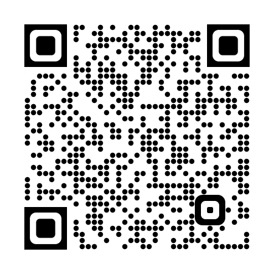
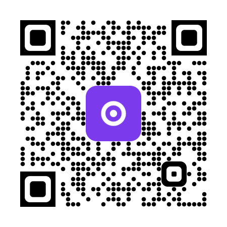
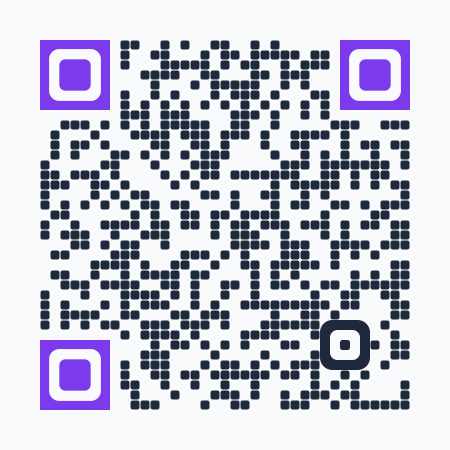
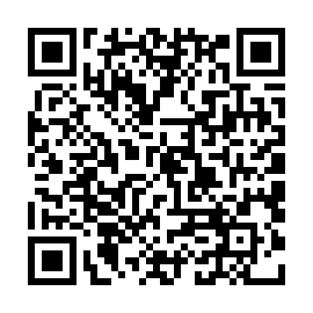
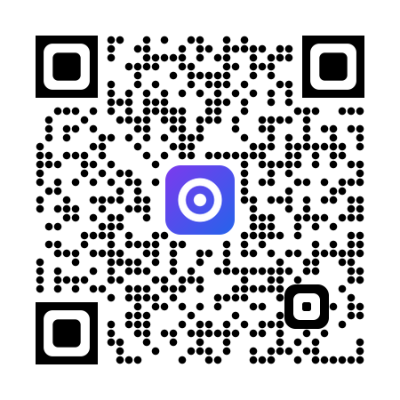

# styled-qr

[](https://github.com/bipa-app/styled-qr/actions/workflows/ci.yml)
[](https://crates.io/crates/styled-qr)
[](https://docs.rs/styled-qr)

Styled QR codes with exact anti-aliasing, logos, and PNG and SVG output.

<p>



</p>

Each pixel gets the exact area of the shapes that cover it, so dots, finder
patterns and logos stay symmetric and centered at every module size. The PNG
and the SVG come from the same scene.

## Usage

```toml
[dependencies]
styled-qr = "0.1"
```

```rust
use styled_qr::{Composer, EcLevel, Layout, ModuleSize, QuietZone, Symbol};

fn main() -> Result<(), Box<dyn std::error::Error>> {
    let symbol = Symbol::encode(b"https://example.com", EcLevel::H)?;
    let layout = Layout::new(ModuleSize::new(10)?, QuietZone::new(4)?);
    let scene = Composer::new(&symbol, layout).compose()?;
    std::fs::write("qr.png", scene.to_png()?)?;
    std::fs::write("qr.svg", scene.to_svg()?)?;
    Ok(())
}
```

`ModuleSize` is the side of one module in pixels, and `QuietZone` is the empty
border in modules. `Layout::fit` picks the largest module size that fits a
pixel budget.

## Gallery

Each example continues the one above, with the same `symbol` and `layout`.
[`examples/gallery.rs`](examples/gallery.rs) renders every image on this page
and checks that each one decodes. Run it from the repository root with
`cargo run --example gallery`.

<table>
<tr>
<td></td>
<td>

**Dots**, the default style.

```rust
let scene = Composer::new(&symbol, layout).compose()?;
```

</td>
</tr>
<tr>
<td></td>
<td>

**Connected**. Each module joins its dark neighbors.

```rust
let scene = Composer::new(&symbol, layout)
    .style(Style::CONNECTED)
    .compose()?;
```

</td>
</tr>
<tr>
<td></td>
<td>

**Classic**. Square modules and finder patterns.

```rust
let scene = Composer::new(&symbol, layout)
    .style(Style::CLASSIC)
    .compose()?;
```

</td>
</tr>
<tr>
<td></td>
<td>

**Logo**. The composer clears the modules behind the logo and checks that the code still decodes.

```rust
let logo = Logo::new(&image::open("assets/badge.png")?)?;
let scene = Composer::new(&symbol, layout).logo(&logo).compose()?;
```

</td>
</tr>
<tr>
<td></td>
<td>

**Plate**. A rounded backing turns a transparent mark into a badge.

```rust
let logo = Logo::new(&image::open("assets/mark.png")?)?.with_plate(Plate {
    color: Color::rgb(124, 58, 237),
    margin: Ratio::new(0.2)?,
    roundness: Roundness::new(0.4)?,
});
let scene = Composer::new(&symbol, layout).logo(&logo).compose()?;
```

</td>
</tr>
<tr>
<td></td>
<td>

**Colors and shapes**. Rounded modules, a slate palette and violet finder patterns.

```rust
let style = Style {
    module: ModuleShape::Rounded {
        size: Ratio::new(0.9)?,
        roundness: Roundness::new(0.5)?,
    },
    palette: Palette::new(Color::rgb(30, 41, 59), Color::rgb(248, 250, 252))?
        .with_finder(Color::rgb(124, 58, 237))?,
    ..Style::DOTS
};
let scene = Composer::new(&symbol, layout).style(style).compose()?;
```

</td>
</tr>
<tr>
<td></td>
<td>

**SVG**. The same scene as an SVG file. This image is the SVG.

```rust
std::fs::write("assets/colors.svg", scene.to_svg()?)?;
```

</td>
</tr>
</table>

## Styles

| Preset | Modules | Finder patterns | Alignment patterns |
| --- | --- | --- | --- |
| `Style::DOTS` (default) | dots | square frame, rounded hole and stone | rounded |
| `Style::CONNECTED` | tiles that join their dark neighbors | as `DOTS` | as `DOTS` |
| `Style::CLASSIC` | squares | squares | plain modules |

Other styles combine `ModuleShape`, `PatternShape`, `AlignmentStyle`, `Palette`
and `Blending`. `Palette::new` refuses colors with a contrast ratio below 3:1.
`Blending::Linear` mixes edge pixels in linear light.

Rounded outer finder corners move the corner estimates of quirc-family
decoders, so the presets keep the outer frame square.

## Logos

The composer clears the modules behind the logo. Then it counts the codewords
that the logo makes read wrong in each error correction block. It refuses a
logo that:

- uses more than its error budget, by default 75% of the correction capacity
  of the worst block,
- hides a finder, separator or timing module,
- damages the format or version information more than BCH can correct.

With `OverBudget::Shrink`, the default, the composer tries the logo at 90% down
to 50% of its size before it returns the error. `Clearance` selects the area to
clear: the convex hull of the logo (default), its opaque pixels, or its
bounding box. `Plate` draws a rounded backing behind the logo.

## Tests

The tests decode the output with [quircs](https://crates.io/crates/quircs),
compare each symbol with the [qrcode](https://crates.io/crates/qrcode) crate,
and compare the coverage of each shape with supersampling.

## Credits

styled-qr started as the QR code renderer of the [Bipa](https://bipa.app)
backend. The commit history keeps each author of that work.

## License

MIT. See [LICENSE](LICENSE).
